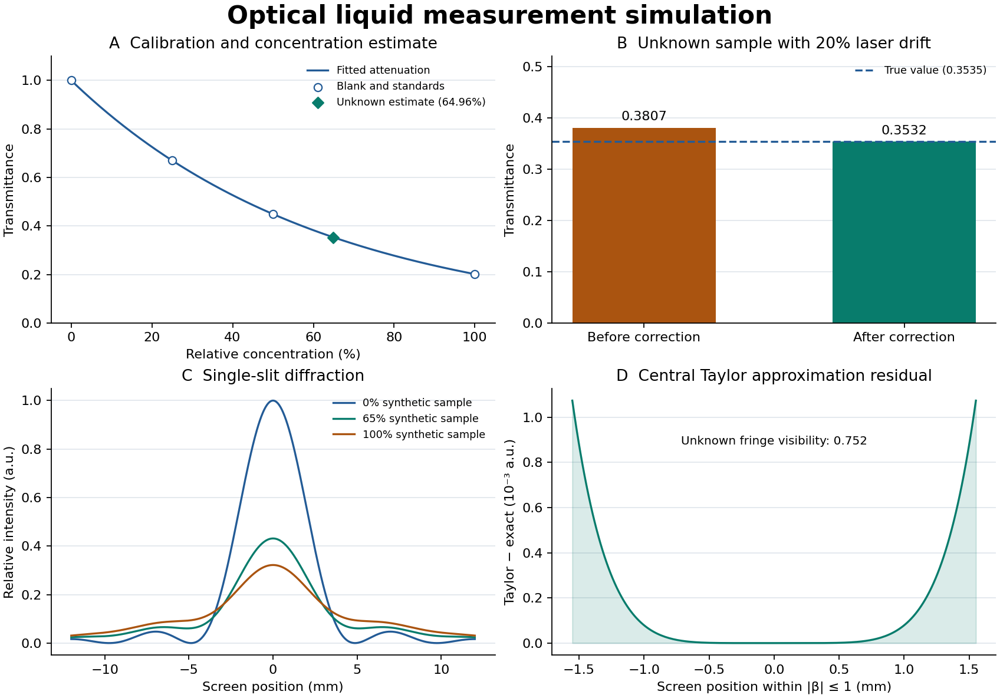

# 광학 회절을 이용한 액체 오염도 간이 측정기 시뮬레이션

대학 물리학과 AI 코딩 과제의 06번 프로젝트입니다. 레이저 출력이 20% 낮아진 합성 미지 시료를 대상으로, 주변광 차분과 참조광 보정이 투과율 추정에 얼마나 영향을 주는지 확인했습니다. 미지 시료의 상대 농도는 **64.9599%**로 추정됐고, 시뮬레이션에 넣은 65.0000%와의 차이는 **0.0401%p**였습니다.

## 웹에서 바로 실행

[**액체 오염도 간이 측정기 시뮬레이터 열기**](https://sihyeon10222.github.io/optical-liquid-turbidity-sim/)

오프라인에서는 [최신 릴리스의 HTML 파일](https://github.com/sihyeon10222/optical-liquid-turbidity-sim/releases/latest/download/liquid-simulator.html)을 내려받아 브라우저로 열면 됩니다. 외부 라이브러리나 서버 없이 동작합니다.

3D 광학 브레드보드 위에서 빛이 시료와 참조 경로로 나뉘는 모습을 확인합니다. 상대 농도를 높이면 큐벳 안에서 빛이 지수적으로 약해지고 산란광과 입자가 늘며, 스크린의 회절 무늬가 달라집니다. 출력을 0%로 낮추면 빛이 꺼지고 농도 추정이 중단됩니다.

- **시점 조작**: 드래그로 회전하고, 장면을 누른 뒤 휠이나 핀치로 확대합니다. 기본·정면·빛 따라가기·위 시점 버튼과 방향키를 쓸 수 있습니다.
- **부품 설명**: 빔 스플리터, 큐벳, 슬릿, 스크린, 참조 센서를 누르면 카메라가 다가가고 원리와 현재 값(투과율, 첫 어두운 무늬 위치, 차분 전압 등)이 나타납니다. 레이저를 누르면 켜고 끕니다.
- **시료 교체**: 장면이나 조건 패널의 시료병(블랭크, 25%, 50%, 미지 65%, 100%)을 누르면 큐벳이 올라갔다 새 시료로 바뀌어 내려옵니다.
- **슬릿 폭**: 40–160 µm로 바꾸면 회절 그래프와 스크린 무늬, 빛의 퍼짐이 바뀝니다. 기본값은 Python판과 같은 80 µm이며 농도 추정에는 영향을 주지 않습니다.
- **ON/OFF 변조 보기**: 500 Hz 변조를 느리게 깜빡여 보여 주고, 센서 전압 파형에서 주변광과 120 Hz 깜빡임 위에 레이저 성분이 얹히는 모습과 ON−OFF 평균 차분을 표시합니다.

빛의 이동 속도, 입자, 경로 색은 이해를 돕기 위한 표현입니다. 두 경로의 광량 표시는 각 경로의 최대값에 대한 상대값입니다.

브라우저판은 아래 Python판과 같은 감쇠·보정·회절식을 사용하고, 센서 잡음은 JavaScript에서 별도의 고정 시드로 생성합니다. 아래 그림과 표는 Python판의 결과입니다.

### 20초 자동 데모와 시연 영상

페이지 위쪽의 **▶ 자동 데모 20초**를 누르면 카메라 이동, 조작, 자막이 20초 동안 자동으로 진행됩니다. 주소 끝에 `?demo`를 붙여 열면 바로 시작합니다. 장면을 누르면 데모가 멈춥니다.

데모 순서: 두 경로 소개 → 빔 스플리터 설명 → 큐벳 설명과 100% 시료 교체 → 블랭크 교체 → 슬릿 폭 80→40→160→80 µm 변화 → ON/OFF 변조와 추정값 64.98% → 레이저 출력을 0%로 낮춰 추정 중단 → 원래 상태로 복귀

**● 데모 녹화 (영상 저장)**를 누르면 같은 데모를 실행하면서 3D 장면과 자막을 영상 파일(`액체오염도측정-데모.mp4`, 브라우저에 따라 `.webm`)로 내려받습니다. 아래 패널까지 함께 찍으려면 macOS `⌘⇧5` 또는 Windows `Win+Alt+R` 화면 녹화로 데모를 촬영합니다.



## 시스템 개요 및 하드웨어 구성

레이저 빛을 빔 스플리터로 시료 경로와 참조 경로로 나눕니다. 시료 센서는 큐벳을 지난 축상 투과광을, 참조 센서는 큐벳을 거치지 않은 광량을 기록합니다. 회절 무늬는 큐벳을 통과한 빛을 별도로 슬릿에 보낸 경우의 스크린 강도 분포로 계산합니다.

| 개념 장치 | 시뮬레이션에서의 역할 |
| --- | --- |
| 650 nm 레이저와 타이밍 제어기 | 500 Hz로 레이저를 켜고 끄며 시료와 참조 센서를 동기 샘플링 |
| 빔 스플리터와 참조 포토다이오드 | 시료 채널과 동일한 광원 출력 변동을 기록 |
| 1 cm 큐벳과 시료 포토다이오드 | 합성 시료에서 감쇠한 투과광을 전압으로 변환 |
| 폭 80 µm 단일 슬릿과 0.60 m 거리의 스크린 | 프라운호퍼 회절 무늬의 가로 단면을 계산 |

## 알고리즘 및 수학적 모델

### 투과율 보정과 농도 추정

상대 농도 `c`를 0–1로 놓고, 길이 `L = 0.01 m`인 큐벳을 통과하는 빛의 투과율을 `T(c) = exp(−μLc)`로 생성합니다. `μ = 160 m⁻¹`은 합성 실험의 감쇠 계수입니다. 출력 변화는 두 채널의 레이저 성분에 공통으로 곱하고, 채널별 환경광 오프셋, 120 Hz 조명 깜빡임, 센서 잡음을 더합니다. [IUPAC 비어–람베르트 법칙](https://www.old.goldbook.iupac.org/html/B/B00626.html)

1. 500 Hz의 ON/OFF 100쌍에서 채널별 평균 전압 차 `ΔV = mean(V_ON − V_OFF)`를 구합니다. 고정 주변광은 차분으로 제거되고, 이 시뮬레이션의 0.20초 창에는 120 Hz 성분이 24주기 들어가 평균에서 상쇄됩니다.
2. 시료와 참조 채널의 차분 비 `R = ΔV_sample / ΔV_reference`를 구합니다. 농도 0%인 블랭크의 비로 나눠 `T = R / R_blank`를 구하면 채널별 이득 차이와 공통 광량 변동이 보정됩니다. 참조 차분이 0.01 V 이하이거나 시료 차분이 0 V 이하이면 추정을 중단합니다.
3. 기지 농도 25%, 50%, 100%의 보정 투과율에서 `−ln(T) = b·c`의 기울기 `b`를 원점을 지나는 최소제곱으로 적합합니다. 미지 시료의 농도는 보정 투과율과 기울기만 사용해 `ĉ = −ln(T) / b`로 계산합니다. 추정치가 0–100% 범위를 벗어나면 그대로 표시하고 경고를 출력합니다.

### 단일 슬릿 회절

스크린 가로 위치를 `x`, 스크린까지의 거리를 `D`, 슬릿 폭을 `a`, 파장을 `λ`라 놓습니다. 위상 변수는 `β = πa·sin(arctan(x/D)) / λ`입니다. 정확한 강도는 `I(x) = T(c)·(sin β / β)² + B(x,c)`로 계산하고, `β = 0`에서는 회절 인자를 1로 처리합니다. `B`는 산란 배경의 영향을 보여주기 위해 추가한 가우시안 항으로, 표준편차를 7 mm, 중심 크기를 `0.12·c`로 가정했습니다. [OpenStax 단일 슬릿 회절](https://openstax.org/books/university-physics-volume-3/pages/4-2-intensity-in-single-slit-diffraction)

중앙부 `|β| ≤ 1`에서는 회절 **강도** 인자를 `1 − β²/3 + 2β⁴/45`로 근사합니다. 프린지 가시도는 `(I_center − I_first) / (I_center + I_first)`이며, `I_first`는 이상적 회절 인자의 첫 영점 `β = π`에 해당하는 위치의 전체 강도입니다. 회절 프로파일과 가시도는 광학 현상을 설명하는 별도 지표이며 농도 추정에는 투과율을 사용합니다.

## 결과

| 미지 시료에서 비교한 지표 | 값 |
| --- | ---: |
| 모델의 참 투과율 | 0.353455 |
| 보정 전 투과율 (시료 ON 전압 ÷ 블랭크 ON 전압) | 0.380656 |
| 보정 후 투과율 | 0.353193 |
| 투과율 절대 오차 (보정 전 → 후) | 0.027201 → 0.000261 |
| 적합한 감쇠 기울기 `b` | 1.602127 |
| 프린지 가시도 | 0.751542 |

투과율 값과 오차는 0–1 척도이며, 보정 전 값에는 광원 변화와 주변광 영향이 함께 들어 있습니다. 농도는 합성 시료 기준의 상대 척도입니다. 실제 액체에 적용하려면 시료별 기준점과 광학 장치의 실측 교정이 필요하며, 120 Hz 상쇄 성능은 샘플링 구간에 따라 달라집니다.

## 실행 방법

Python 3.12 가상 환경에서 저장소 루트의 다음 명령을 실행합니다.

```bash
python -m venv .venv
source .venv/bin/activate
python -m pip install -r requirements.txt
python simulate.py --output-dir results
```

고정 난수 시드 42로 `results/overview.png`와 `results/summary.csv`를 생성합니다. CSV에는 블랭크, 기지 농도 3점, 미지 시료의 투과율과 오차, 가시도가 들어 있습니다. [요약 CSV](results/summary.csv)

## 바이브 코딩 프롬프트 시퀀스

물리 모델을 먼저 실행한 뒤 광학 보정과 농도 역산을 추가하고, 재현 가능한 결과와 설명을 정리했습니다. 이후 단일 HTML 시뮬레이터와 3D 광학 장치를 만들고, 부품 설명과 시료 교체 같은 직접 조작 기능과 20초 자동 데모를 추가했습니다. 단계별 요청과 확인 결과는 별도로 기록했습니다. [프롬프트 기록](PROMPTS.md)
